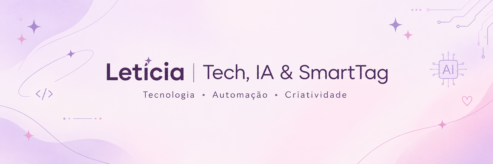

from pathlib import Path
import shutil, zipfile, textwrap

base = Path("/mnt/data/portfolio_leticia_girly_tech")
assets = base / "assets"
assets.mkdir(parents=True, exist_ok=True)

banner_source = Path("/mnt/data/a_wide_pastel_minimalist_dreamy_tech_themed_ban.png")
banner_dest = assets / "banner-girly-tech.png"
if banner_source.exists():
    shutil.copy2(banner_source, banner_dest)

readme = r"""

### ✨ tecnologia com criatividade, propósito e um toque de lilás ✨

Estudante de **Gestão da Tecnologia da Informação** e formada em **Gestão Empresarial**.
Gosto de conectar tecnologia, processos e criatividade para transformar ideias em soluções práticas.

[🌷 Sobre mim](#-sobre-mim) · [💻 Projetos](#-projetos) · [🪻 Tecnologias](#-tecnologias) · [💌 Contato](#-contato)

---

## 🌷 Sobre mim

Oi! Sou a Letícia — curiosa por natureza, apaixonada por aprender e por encontrar maneiras mais inteligentes de fazer as coisas.

Minha trajetória une **gestão, negócios, marketing e tecnologia**. Estou desenvolvendo minhas habilidades em programação e explorando como automação e inteligência artificial podem ajudar pessoas e empresas no dia a dia.

- 🎓 Formada em Gestão Empresarial pela Fatec Botucatu.
- 💻 Estudante de Gestão da Tecnologia da Informação.
- ✨ Interesses: automação de processos, IA aplicada, desenvolvimento web e soluções digitais.
- 🩷 Acredito que tecnologia pode ser útil, acessível e criativa — sem perder a personalidade.

## 💻 Projetos

### 🧮 Calculadora com HTML, CSS e JavaScript
Meu projeto de prática em desenvolvimento front-end e lógica de programação.

- **Tecnologias:** HTML5, CSS3 e JavaScript.
- **Prática:** manipulação do DOM, operações matemáticas e interface responsiva.
- **Repositório:** [ver projeto no GitHub](https://github.com/smarttag-digital/calculadora-html-css-js)

### 🪻 SmartTag
A SmartTag é meu espaço para explorar ideias e desenvolver soluções digitais, aproximando tecnologia, automação, inteligência artificial e necessidades reais de negócio.

> Os projetos e funcionalidades serão documentados aqui conforme forem sendo implementados e validados.

- **GitHub:** [smarttag-digital](https://github.com/smarttag-digital)
- **Instagram:** [@smarttag.digital](https://www.instagram.com/smarttag.digital/)

## 🪻 Tecnologias e temas em desenvolvimento

*Esta seção representa ferramentas e áreas que estudo ou exploro. Vou atualizá-la conforme ganhar experiência prática.*

## 🌸 O que quero construir

Quero crescer na área de tecnologia participando de projetos que conectem **soluções digitais, melhoria de processos e experiência das pessoas** — enquanto desenvolvo a SmartTag com responsabilidade e aprendizado contínuo.

## 💌 Contato

- **GitHub:** [smarttag-digital](https://github.com/smarttag-digital)
- **Instagram da SmartTag:** [@smarttag.digital](https://www.instagram.com/smarttag.digital/)

`feito com curiosidade, café opcional e muitos ✨`

"""

guide = """# Aplicação do perfil GitHub — Letícia | Tech, IA & SmartTag

## Identidade visual

- **Conceito:** Aesthetic girl / Girly Tech
- **Paleta:** lilás `#C9B6F0`, rosa pastel `#F4B8D0`, branco rosado `#FFF7FC`, uva `#423653`
- **Clima:** clean, delicado, criativo e tecnológico
- **Título de perfil:** `Letícia | Tech, IA & SmartTag`

## Arquivos

- `README.md`: conteúdo sugerido para o README do perfil.
- `assets/banner-girly-tech.png`: banner visual para o README.

## Como aplicar

1. Abra https://github.com e confirme seu nome de usuário exato.
2. Crie um repositório **público** com o mesmo nome do usuário. Para o usuário `smarttag-digital`, o repositório especial deve se chamar `smarttag-digital`.
3. Marque a opção para adicionar um README.
4. Envie/substitua o `README.md` deste pacote e envie a imagem para `assets/banner-girly-tech.png`.
5. Faça commit das alterações. O GitHub exibe esse README no perfil quando o repositório público tem exatamente o mesmo nome do usuário.
6. No perfil, ajuste o nome de exibição para `Letícia | Tech, IA & SmartTag`.
7. Sugestão de bio curta: `GTI student | Gestão, tecnologia, automação e IA ✨`
8. Fixe os melhores repositórios no perfil quando tiver projetos públicos prontos e documentados.

## Importante

O conector disponível nesta sessão não retornou os repositórios da conta e não oferece uma ação de criação de repositório ou alteração dos campos do perfil. Por isso, este pacote foi preparado para aplicação manual; nenhuma mudança foi publicada diretamente na sua conta.

Revise links e descrições antes de publicar. Só mantenha tecnologias e funcionalidades que você realmente esteja estudando ou tenha implementado. O README já sinaliza que algumas tecnologias estão em desenvolvimento e que a SmartTag deve ser descrita de acordo com o que estiver efetivamente construído.
"""

(base / "README.md").write_text(readme, encoding="utf-8")
(base / "GUIA-DE-APLICACAO.md").write_text(guide, encoding="utf-8")

zip_path = Path("/mnt/data/portfolio_leticia_girly_tech.zip")
with zipfile.ZipFile(zip_path, "w", compression=zipfile.ZIP_DEFLATED) as zf:
    for p in base.rglob("*"):
        if p.is_file():
            zf.write(p, p.relative_to(base.parent))

print("Pacote criado:", zip_path)
print("README:", base / "README.md")
print("Guia:", base / "GUIA-DE-APLICACAO.md")
print("Banner incluído:", banner_dest.exists())
