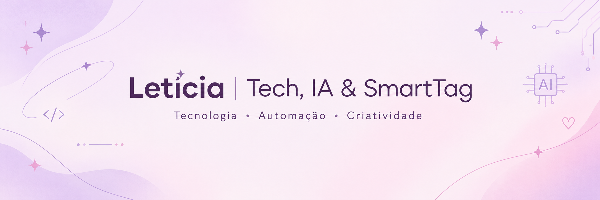

[README.md](https://github.com/user-attachments/files/33835687/README.md)

### ✨ tecnologia com criatividade.

Estudante de **Gestão da Tecnologia da Informação** e formada em **Gestão Empresarial**.
Gosto de conectar tecnologia, processos e criatividade para transformar ideias em soluções práticas.

[🌷 Sobre mim](#-sobre-mim) · [💻 Projetos](#-projetos) · [🪻 Tecnologias](#-tecnologias) · [💌 Contato](#-contato)

---

## 🌷 Sobre mim

Oi! Sou a Letícia , curiosa por natureza, apaixonada por aprender e por encontrar maneiras mais inteligentes de fazer as coisas.

Minha trajetória une **gestão, negócios, marketing e tecnologia**. Estou desenvolvendo minhas habilidades em programação e explorando como automação e inteligência artificial podem ajudar pessoas e empresas no dia a dia.

- 🎓 Formada em Gestão Empresarial pela Fatec Botucatu.
- 💻 Estudante de Gestão da Tecnologia da Informação.
- ✨ Interesses: automação de processos, IA aplicada, desenvolvimento web e soluções digitais.
- 🩷 Acredito que tecnologia pode ser útil, acessível e criativa sem perder a personalidade.

## 💻 Projetos

### 🧮 Calculadora com HTML, CSS e JavaScript
Meu projeto de prática em desenvolvimento front-end e lógica de programação.

- **Tecnologias:** HTML5, CSS3 e JavaScript.
- **Prática:** manipulação do DOM, operações matemáticas e interface responsiva.
- **Repositório:** [ver projeto no GitHub](https://github.com/smarttag-digital/calculadora-html-css-js)

### 🪻 SmartTag
A SmartTag é meu espaço para explorar ideias e desenvolver soluções digitais, aproximando tecnologia, automação, inteligência artificial e necessidades reais de negócio.

> Os projetos e funcionalidades serão documentados aqui conforme forem sendo implementados e validados.

- **GitHub:** [smarttag-digital](https://github.com/smarttag-digital)
- **Instagram:** [@smarttag.digital](https://www.instagram.com/smarttag.digital/)

## 🪻 Tecnologias e temas em desenvolvimento

*Esta seção representa ferramentas e áreas que estudo ou exploro. Vou atualizá-la conforme ganhar experiência prática.*

## 🌸 O que quero construir

Quero crescer na área de tecnologia participando de projetos que conectem **soluções digitais, melhoria de processos e experiência das pessoas** enquanto desenvolvo a SmartTag com responsabilidade e aprendizado contínuo.

## 💌 Contato

- **GitHub:** [smarttag-digital](https://github.com/smarttag-digital)
- **Instagram da SmartTag:** [@smarttag.digital](https://www.instagram.com/smarttag.digital/)

`feito com curiosidade, café opcional e muitos ✨`

